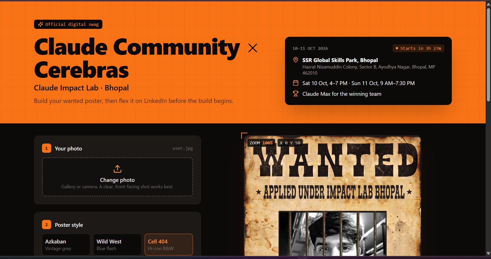
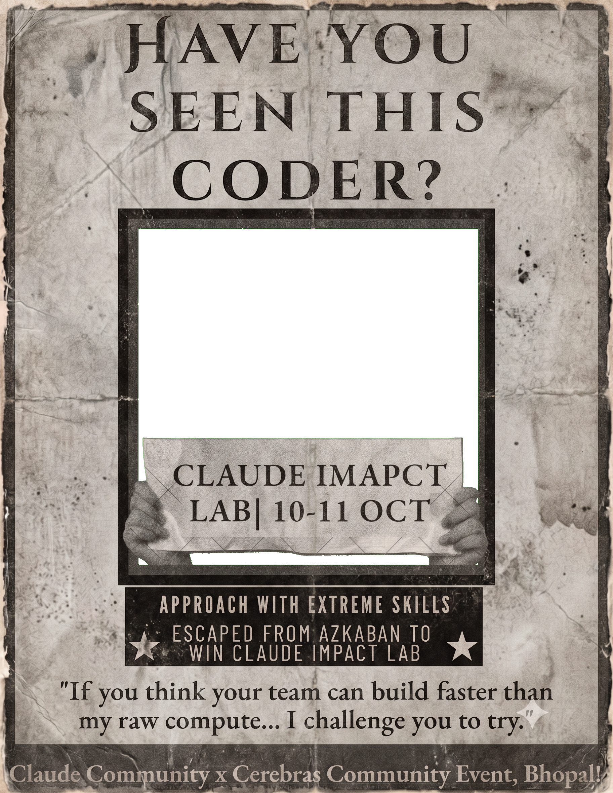
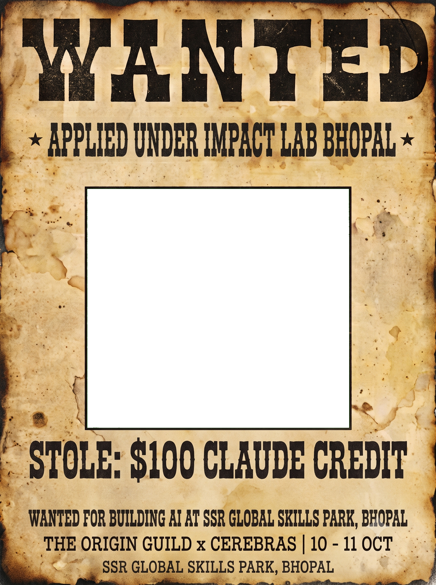
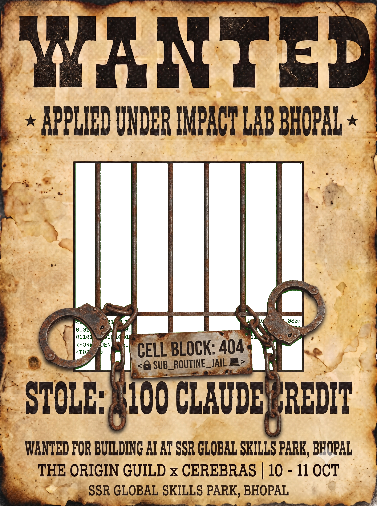
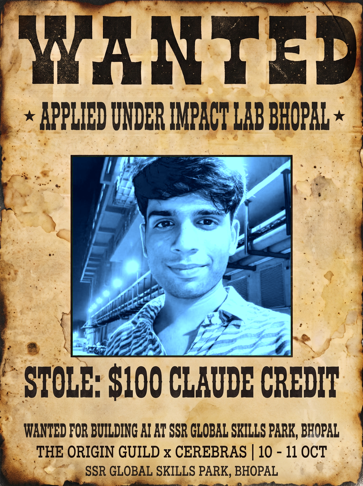
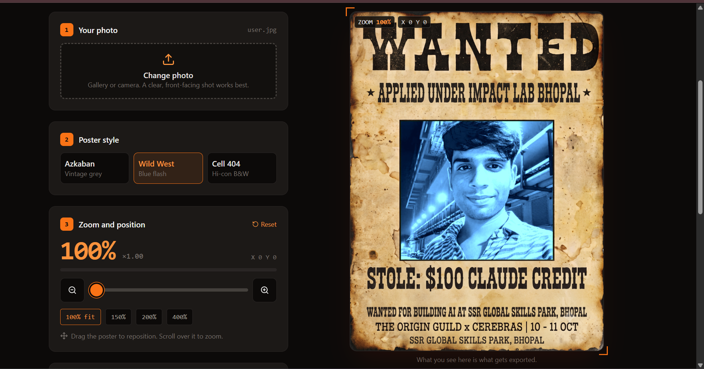

# Poster Lab — Wanted Poster Studio

Upload a selfie, pick a style, zoom & drag it into place, download the HD poster, and share it with a ready-made caption.

Built for **Claude Community × Cerebras — Impact Lab Bhopal** (SSR Global Skills Park, 10–11 Oct 2026).



## Templates

Only transparent cutouts — no green-screen files. The backend composites your photo under the
same frame the React preview shows, so the HD download matches the preview.

| Azkaban (vintage grey) | Wild West (blue flash) | Cell 404 (hi-con B&W) |
|---|---|---|
|  |  |  |
| `filter=azkaban` | `filter=wildwest` | `filter=digital_prison` |

## Example output

HD render from `POST /api/generate` (Wild West, `user.jpg`):



Live preview with zoom / pan HUD:



## Project structure

```text
azkban-poster/
├── backend/
│   ├── app.py        # FastAPI: POST /api/generate, GET /api/health, GET /api/templates
│   ├── process.py    # OpenCV + Pillow compositing (transparent-window only)
│   └── requirements.txt
├── frontend/
│   ├── public/templates/template{1,2,3}.png   # transparent cutouts (sole template source)
│   └── src/components/PosterLabApp.jsx        # upload, preview, zoom/pan, share
├── render.yaml       # Render blueprint (API + static site)
├── output.png        # example HD render (used above)
└── user.jpg          # sample selfie for local testing
```

## Run locally

Two terminals, from this folder:

**Terminal 1 — backend (port 8000):**
```bash
..\.venv\Scripts\Activate.ps1
cd backend
uvicorn app:app --reload --port 8000
```

**Terminal 2 — frontend (port 5173):**
```bash
cd frontend
npm install
npm run dev
```

Open `http://localhost:5173`. Vite proxies `/api` → `127.0.0.1:8000` (see `frontend/vite.config.js`).

## API

| Method | Endpoint | Input | Output |
|---|---|---|---|
| `POST` | `/api/generate` | multipart: `photo` (file), `template` (`azkaban`/`wildwest`/`digital_prison`), `name`, `zoom` (0.2–5), `offset_x`, `offset_y` | `image/png` poster |
| `GET` | `/api/templates` | — | template list + availability |
| `GET` | `/api/health` | — | `{status: ok}` (Render health check) |

## Deploy on Render

`render.yaml` defines both services. Push this folder as the repo root, then
Render Dashboard → New → Blueprint → select the repo → Apply.

- `poster-lab-api` (Python, free): `pip install -r requirements.txt`, `uvicorn app:app --host 0.0.0.0 --port $PORT`
- `poster-lab-web` (static, free): `npm install && npm run build`, publishes `dist`, `VITE_API_URL` auto-wired to the API host

Notes: `opencv-python-headless` is used (Render has no `libGL`); temp uploads are deleted after each response; the free API sleeps when idle (~30s cold start).

## Tech

React 18 + Vite 5 + Tailwind CSS 3 + lucide-react · FastAPI + Uvicorn + OpenCV (headless) + Pillow + NumPy
